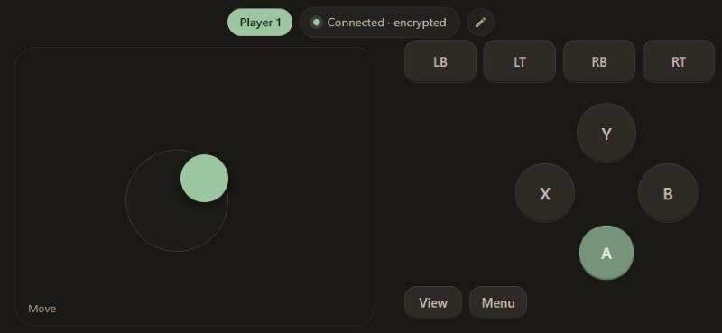
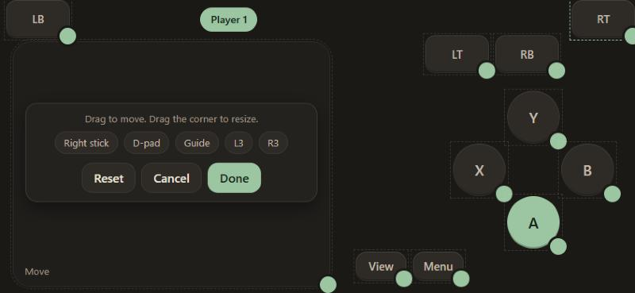

<div align="center">


# Padette

### Every phone is a controller

Turn phones into Xbox controllers for your Windows PC. Friends come over, scan a QR code and play as player 2, 3 or 4.<br>
**Runs in the phone's browser: no app to install, no account, no cloud.**

<br>

<a href="https://github.com/Dizyy/Padette/releases/latest/download/Padette.exe"></a>
&nbsp;
<a href="#security"></a>

<br>

[](https://github.com/Dizyy/Padette/releases/latest)
[](#what-works-where)
[](#1-download)
[](LICENSE)

<br>



</div>

<br>

<table>
<tr>
<td width="33%" align="center" valign="top">

**1. Download `Padette.exe`**<br>
<sub>One file, no installer. Plus the free ViGEmBus driver, once.</sub>

</td>
<td width="33%" align="center" valign="top">

**2. Scan the QR code**<br>
<sub>With each phone's camera. It connects encrypted.</sub>

</td>
<td width="33%" align="center" valign="top">

**3. Turn the phone sideways**<br>
<sub>You're Player 1, 2, 3 or 4. Start the game.</sub>

</td>
</tr>
</table>

> [!NOTE]
> **Is it safe? Yes: no virus, no tracker, no ads.**
> - **Nothing is collected.** No accounts, no analytics, no ads, no tracking. Padette never sends your button presses or anything else to the internet.
> - **It only talks to GitHub,** once at start, to check for a new version (turn it off with `--no-update`). Everything else stays between the phones and your PC, on your own Wi-Fi.
> - **It needs one driver: ViGEmBus,** a free, open-source driver that lets programs add virtual Xbox controllers. You install it yourself, once. Padette never installs anything.
> - **Guests can't touch your PC.** A phone logged in to Padette can only press controller buttons: no mouse, no keyboard, no files.
> - **You can check every line.** The PC program and the phone page are open source, all in this repo.
> - **Nothing stays behind.** It installs no service and doesn't start with Windows. **Quit Padette** stops it completely, and deleting the file removes it.
> - **Locked to you.** A new random PIN on every start, and an encrypted connection when you scan the QR code.
>
> **Why does Windows warn me?** "Windows protected your PC" shows because `Padette.exe` isn't signed with a paid code signing certificate yet, not because something was found in it. Want to check it yourself? Upload it to [VirusTotal](https://www.virustotal.com), compare its SHA-256 with the one on the [release page](https://github.com/Dizyy/Padette/releases/latest), or [run it from source](#1-download) instead.

## Your layout, your triggers

<table>
<tr>
<td width="50%" align="center" valign="top">


**Play**<br>
<sub>The left half is the stick: put your thumb down anywhere and slide, no aiming for a small circle. Big A, B, X, Y on the right, LB, LT, RB and RT along the top. Press several at once.</sub>

</td>
<td width="50%" align="center" valign="top">



**Move buttons**<br>
<sub>Tap the pencil, drag any button, drag its corner to resize. Turn on a right stick, D-pad, Guide, L3 and R3. Got clip-on phone triggers? Put LB and RB right under the clips: the corners are always free.</sub>

</td>
</tr>
</table>

## Made for real life

- **Friends over, one controller:** everyone else plays with the phone already in their pocket.
- **Kids and family:** a quick game on the TV without buying and charging four controllers.
- **Party games:** up to 4 phones, each with its own player number and colour.
- **Controller died mid-game:** grab your phone and keep playing.
- **Clip-on triggers:** cheap phone triggers press the screen; move LB, RB, LT and RT exactly under them.

## Why Padette?

A program that adds controllers to your PC and lets other people's phones connect has to be one you can trust. Padette works like this:

- **Open source (AGPL-3.0):** every line of the PC program and the phone page is in this repo, and every changed copy someone shares has to stay open source too.
- **Only controller buttons:** a guest's phone can press A, B, X, Y, the sticks and triggers. It can't move your mouse, type, open programs or read files.
- **Nothing left running:** **Quit Padette** stops it completely and removes its virtual controllers. It doesn't start with Windows and installs no service.
- **No tracking:** no accounts, no ads, no analytics. The only internet request is the update check on GitHub at start, which you can turn off with `--no-update`.
- **Stays on your home network:** the phones talk straight to your PC. Nothing goes through a cloud server, and the phone page loads nothing from the internet.
- **Encrypted:** scan the QR code and everything between the phone and the PC is encrypted. Others on your Wi-Fi can't read it, and recorded traffic can't be replayed.
- **No phone app:** it runs in the phone's browser, so there's nothing to install from an app store.

## Features

- **Real Xbox controllers:** each phone shows up in Windows as an Xbox 360 controller, so nearly every PC game with controller support just works, including Steam and Game Pass games.
- **Up to 4 players:** each phone shows its player number (the one games show) in its own colour. A 5th phone is told the game is full. Windows allows 4 Xbox controllers in total, so a real one plugged in takes one of the spots.
- **Floating stick:** the stick appears where your thumb lands on the left half, with a small dead zone so it doesn't drift.
- **No stuck buttons:** if a phone locks, switches app or loses Wi-Fi, all its buttons are released within a second. Its controller stays plugged in for 30 seconds, so the game doesn't pause; come back in time and you're the same player.
- **Your layout:** move and resize every button, add a right stick, D-pad, Guide, L3 and R3. Saved on each phone.
- **Vibration:** when the game rumbles, Android phones buzz. (iPhone browsers can't vibrate.)
- **Quick to connect:** scan the QR code in the Padette window with the phone camera. The key in the QR code encrypts the connection (XSalsa20-Poly1305 from the NaCl library) and never travels over the network. Details: [PROTOCOL.md](PROTOCOL.md#encryption).
- **Same phone twice is fine:** opening Padette in a second tab doesn't make a second controller; the old tab offers **Use here** instead.

## What works where

| | Status |
|---|---|
| **Windows 10 / 11** PC | Tested |
| **iPhone / iPad** (Safari) | Tested |
| **Android** (Chrome and other browsers) | Should work, more testing welcome. Use the QR code or the IP address: Android can't open `padette.local`. |
| **macOS / Linux** | Not supported: the controller driver is Windows only. |

The phones and the PC must be on the **same home network** (the PC can be on Wi-Fi or Ethernet). Triggers are on/off, because phones can't feel how hard you press.

## What's in the folder

- `server/`: Python server (FastAPI + uvicorn)
  - `pad.py`: the virtual Xbox controllers (ViGEmBus through [vgamepad](https://github.com/yannbouteiller/vgamepad)), plus a dry-run mode that only logs
  - `players.py`: one controller per phone, player numbers, the 1 s release and the 30 s hold
  - `protocol.py`: checks that incoming messages are valid
  - `app.py`: the `/ws` WebSocket endpoint and the web page hosting
  - `__main__.py`: startup (finds the PC's network address and a free port, makes the PIN, prints the banner)
  - `tray.py`: the window and tray icon of `Padette.exe`
  - `mdns.py`: makes `padette.local` point at this PC, so iPhones don't need the IP address
  - `update.py`: checks GitHub for a new version when Padette starts, and installs it
  - `encryption.py`: the encryption key and encrypted connections (PyNaCl)
  - `qr.py`: draws the QR code as text for the console window
- `client/`: the web page for the phone (plain HTML/CSS/JS, no build step); `client/vendor/` holds [tweetnacl.js](https://github.com/dchest/tweetnacl-js) 1.0.3 (public domain) for encryption
- `PROTOCOL.md`: the messages the phone and the server exchange
- `tests/`: automated tests
- `tools/`: `pad_probe.py` (checks the real driver), `make_icons.py` (draws the icons)
- `start.bat`: one-click start from source
- `uninstall.bat`: removes the source version
- `padette.py`, `build.py`: entry point and build script for the single-file `Padette.exe`

## 1. Download

**Windows (easiest):** download **`Padette.exe`** from the [latest release](https://github.com/Dizyy/Padette/releases/latest) and put it in any folder, for example your Documents. That's all: no Python, no installer.

Windows may show **"Windows protected your PC"** the first time, because Padette isn't signed with a code signing certificate yet. Click **More info → Run anyway**.

On Windows 11 with **Smart App Control** turned on, Windows may block `Padette.exe` without a **Run anyway** button. Use the source version below instead.

**From source:**
1. Install **Python 3.11+** from <https://www.python.org/downloads/>. Tick **"Add python.exe to PATH"** during installation.
2. On GitHub, click **Code → Download ZIP** and unzip it, for example to `C:\Padette`, or run `git clone https://github.com/Dizyy/Padette.git`.

## 2. Install the controller driver (once)

Padette needs **ViGEmBus**, a free, open-source driver that lets programs add virtual Xbox controllers:

1. Open the [ViGEmBus releases page](https://github.com/nefarius/ViGEmBus/releases) and download the latest `ViGEmBus_..._x64_x86_arm64.exe`.
2. Run it and click through the installer. You may need to restart the PC.

The Padette window shows **Controller driver missing** with a download button until it's installed. Phones that connect without it see the same message.

## 3. Start it

**`Padette.exe`:** double-click it. The Padette window opens and shows:
- the QR code (click **Show QR encryption code**: it holds the encryption key, so it stays hidden until you ask) and the PIN
- the addresses to open on the phone
- which players are connected, and who is away

Closing the window keeps Padette running in the tray, next to the clock. **Quit Padette** there stops it.

**From source:** double-click **`start.bat`**. The first start creates a Python environment in `.venv` and installs what's needed. The console window shows the address, the PIN and a QR code.

Options (from source, or after `Padette.exe` in a shortcut): `--host 192.168.x.x` picks the network address, `--port 9000` another port, `--no-update` skips the update check, `--new-key` makes a new encryption key (every phone must scan again), `--dry-run` logs controller input instead of using the driver.

## 4. Allow Padette through the firewall (private networks only)

The first time Padette starts, Windows usually shows a **"Windows Defender Firewall has blocked some features"** prompt for Padette (or Python, when you run from source):

1. Tick **Private networks**.
2. Leave **Public networks** unticked.
3. Click **Allow access**.

If you missed the prompt, or the phone can't connect:

1. Open **Start → "Allow an app through Windows Firewall"**.
2. Click **Change settings**, then find **Padette** (or **Python** / `python.exe` from source). If it isn't listed, use **Allow another app…** and browse to `Padette.exe` (from source: `Padette\.venv\Scripts\python.exe`).
3. Tick **Private** only, then click **OK**.

Also check that Windows treats your home network as **Private**: **Settings → Network & internet → Wi-Fi** (or **Ethernet**) **→ your network → Network profile type → Private network**.

## 5. Play

1. **Scan the QR code** in the Padette window with the phone camera, and open the link.
2. **Turn the phone sideways.** The badge at the top shows your player number.
3. **Start your game** and pick controller input if it asks. Friends do the same with their phones.

**Tip:** on iPhone, tap **Share → Add to Home Screen**; Padette then opens full screen, without the browser bars. On Android, the first tap switches to full screen by itself.

To check the controllers outside a game: press **Win+R**, type `joy.cpl` and press Enter. Each phone is listed as an Xbox 360 controller.

## Updates

Each time Padette starts, it checks GitHub for a new version. If there is one, it downloads it and restarts itself, which takes a few seconds: `Padette.exe` replaces itself, and the source version replaces its files. Without internet it just starts the version you have.

To skip the check once, start it with `--no-update`. A folder made with `git clone` is never updated automatically; run `git pull` there instead.

## Uninstall

**`Padette.exe`:** quit it (tray icon → **Quit Padette**), then delete the file (and `Padette.exe.old` next to it, if there is one), and the folder `%APPDATA%\Padette` with the encryption key and log. If you allowed it through the firewall, remove that entry under **Start → "Allow an app through Windows Firewall"**. On the phone, remove the home-screen icon.

**From source:** double-click **`uninstall.bat`** in the Padette folder, answer **Yes** in the Windows prompt and press **Y** to confirm.

**The driver:** if no other program needs it, remove **ViGEm Bus Driver** under **Settings → Apps → Installed apps**.

## Troubleshooting

**The page doesn't load on the phone.**
- Check that Padette is still running: its icon is in the tray.
- Check that the phone is on the same network, not on mobile data or a guest Wi-Fi. Guest networks usually isolate devices from each other.
- Check the firewall (step 4), including that the network is set to **Private**.
- Type the address exactly as the Padette window shows it, starting with `http://`, not `https://`.
- On Android, `padette.local` never loads: Android browsers can't open `.local` names. Use the QR code or the IP address.

**"Controller driver missing".** Install ViGEmBus (step 2), then restart Padette.

**"Game is full (4 players)".** Windows allows 4 Xbox controllers at once, real ones included. Unplug a real controller, or wait: a phone that left frees its spot after 30 seconds.

**The game doesn't react.** Check `joy.cpl` (step 5) first. Some games only listen to the first controller until you press a button on it, or need controller input turned on in their settings. Steam: **Settings → Controller** should allow Xbox controllers.

**"Open in another tab".** Padette is open in another tab or browser on this phone. Tap **Use here** to move the controller to this tab.

**Where's the log?** Right-click the tray icon → **Open log**. It's the file `%APPDATA%\Padette\padette.log`. From source, everything is in the console window.

**"Wrong PIN" or "The PIN on the PC has changed".** Padette was restarted: scan the QR code again or enter the new PIN.

## Security

- The server only listens on your **local network address**, and only accepts connections from local network devices. It isn't reachable from the internet, and you should **not** set up port forwarding for it.
- Every connection needs the PIN, which is random and changes on each start. After the PIN, the phone saves a random login token so it can reconnect after being locked; the token stops working when the server restarts. After 5 wrong PINs from a device, that device is locked out for 60 seconds; after 10 wrong PINs from any devices combined, everyone is locked out for 60 seconds.
- A logged-in phone can only send controller input: buttons, sticks and triggers. There is no message for the mouse, the keyboard, files or programs.
- Only Padette's own page can connect. Other websites open in a browser on your network can't connect to it or guess the PIN in the background.
- **Encryption:** when you connect by scanning the QR code, everything between the phone and the PC is encrypted, including the PIN. The QR code carries a secret key that never travels over the network. If you **type** the PIN instead, the connection is **not** encrypted, and the page tells you so. Details: [PROTOCOL.md](PROTOCOL.md#encryption).
- The key is saved on the PC (`%APPDATA%\Padette\key`). To unpair all phones, start Padette with `--new-key` and scan the new QR code.
- The optional **Guide** button (off by default) opens the Xbox Game Bar, which the controller can then use. Leave it off if you don't want guests in Game Bar.
- The Padette window shows the PIN and a QR code that logs in with it. Close or minimise the window before you share your screen or stream.

## Testing

Run `start.bat` once first so `.venv` exists, then:

```bat
.venv\Scripts\python.exe tests\smoke_test.py
.venv\Scripts\python.exe tests\pad_test.py
.venv\Scripts\python.exe tests\players_test.py
.venv\Scripts\python.exe tests\update_test.py
node tests\layout_test.js
```

They run in dry-run mode on 127.0.0.1, so no real controllers are created. The smoke test logs in up to 5 phones, checks player numbers, "game is full", the release after silence, the 30 s hold, encryption, wrong PINs and malformed messages.

`tools\pad_probe.py` checks the real driver: it plugs in 2 virtual controllers for a few seconds and shows what Windows sees.

## Building Padette.exe

```bat
.venv\Scripts\python.exe build.py
```

It installs [PyInstaller](https://pyinstaller.org/), Pillow (for the icon) and pystray (for the tray icon) into `.venv`, which are only needed for building, and writes `dist\Padette.exe`. Attach that file to each GitHub release with exactly that name: the updater downloads it from there.

## Feedback

- **Found a bug?** [Report it](https://github.com/Dizyy/Padette/issues/new?template=bug_report.yml).
- **Want a new feature?** [Suggest it](https://github.com/Dizyy/Padette/issues/new?template=feature_request.yml).
- **Using Padette?** Tell us which games you played, and give the repo a ⭐ if you like it.

Please never post your PIN or IP address.

## Credits

Padette is the little sister of [Mousette](https://github.com/Dizyy/Mousette) (phone as trackpad and keyboard), and shares its login, encryption and PC window. Virtual controllers by [ViGEmBus](https://github.com/nefarius/ViGEmBus) through [vgamepad](https://github.com/yannbouteiller/vgamepad).

## License

Copyright (c) 2026 Dizyy. Padette is free software under the [GNU Affero General Public License v3.0](LICENSE) (AGPL-3.0): you may use, change and share it, and if you share a changed version, or let others use it over a network, you must publish its source code under the same license.
